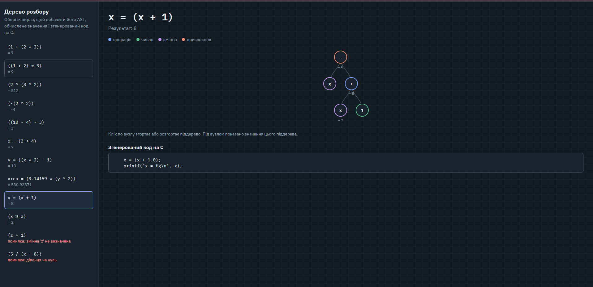

# Lab 3. Парсер арифметичних виразів (flex + bison)

Програма розбирає арифметичні вирази зі змінними, будує AST, обчислює результат,
генерує еквівалентний код на C і зберігає дерево для перегляду в браузері (d3.js).

Підтримується: числа, змінні, `+ - * / % ^`, унарний мінус, дужки, присвоєння `x = ...`.

## Запуск

```bash
make
./calc examples/input.txt     # обчислення + генерація out.c і viz/ast.js
./calc -t examples/input.txt  # вивести токени
make run                      # зібрати out.c і порівняти результат з інтерпретатором
make conflicts                # граматика без пріоритетів -> shift/reduce конфлікти
```

Візуалізація: відкрити `viz/index.html` у браузері.



## Файли

- `lexer.l` — лексер (flex)
- `parser.y` — граматика і побудова AST (bison)
- `ast.c`, `ast.h` — обчислення, генерація C, експорт у JSON
- `main.c` — точка входу
- `examples/` — приклад вхідних даних і результат
- `viz/` — візуалізація AST
